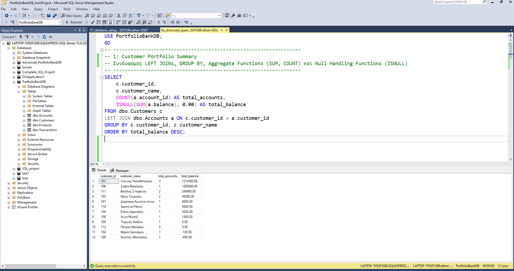
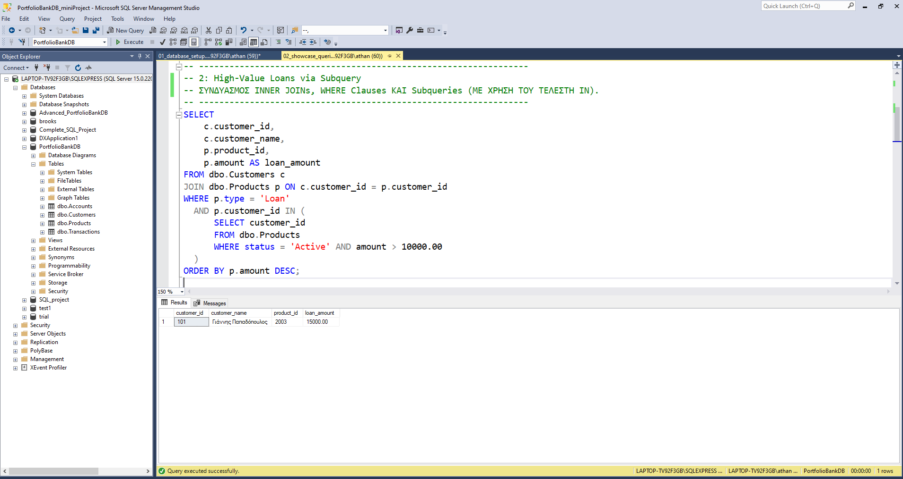
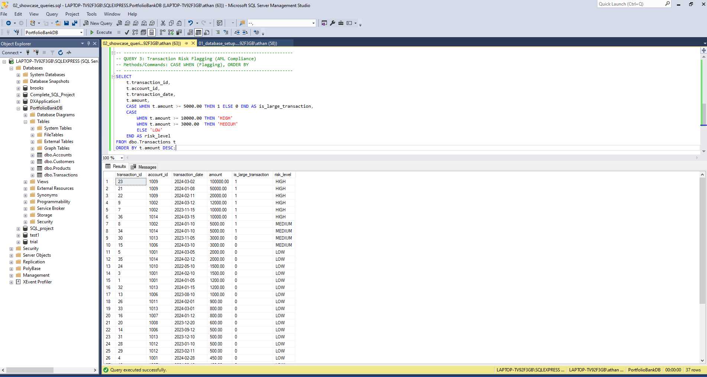
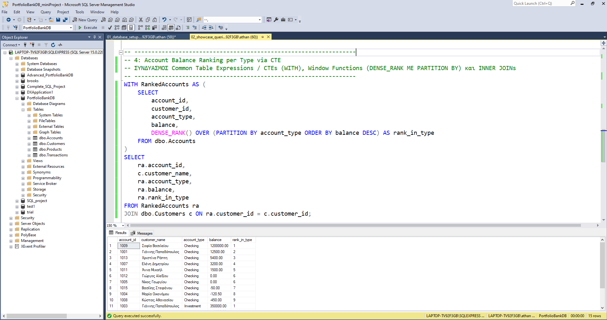
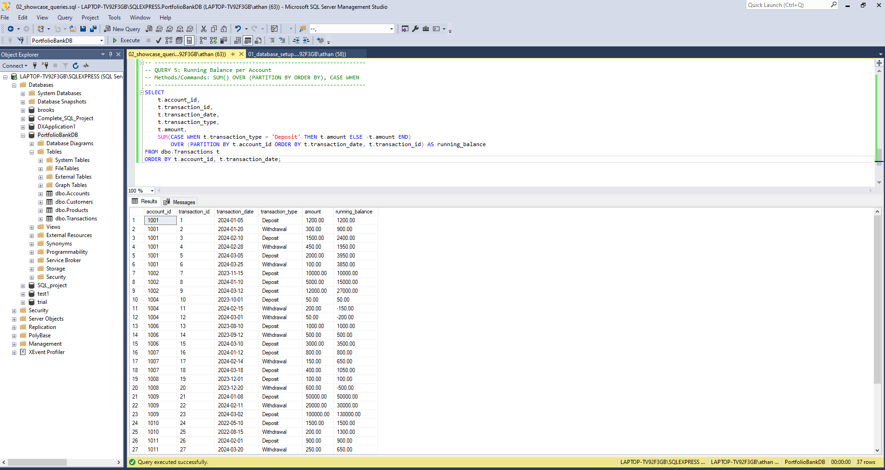

# PortfolioBankDB - T-SQL Mini Project

A T-SQL mini project simulating core banking transactions and demonstrating key SQL concepts and database design using Microsoft SQL Server (SSMS).

---

## 🛠️ Project Structure & Architecture

The project consists of two main T-SQL scripts:
1. **`01_db_setup.sql`**: Handles Database Creation, Schema Design (DDL), Data Population, and Foreign Key integrity rules.
2. **`02_showcase_queries.sql`**: Contains 5 practical business queries demonstrating Joins, Aggregations, Subqueries, Flagging, CTEs, and Window Functions.

---

## 📸 Database Setup & Schema

The database models a simple banking architecture with four tables: `Customers`, `Accounts`, `Products`, and `Transactions`.

---

## 📊 Showcase Queries

### 1. Customer Portfolio Summary
Calculates total accounts and total balance per customer using aggregate functions and left joins.
* **Methods:** `LEFT JOIN`, `GROUP BY`, `SUM()`, `COUNT()`, `ISNULL()`

---

### 2. High-Value Loans via Subquery
Identifies active loans linked to high-value customer criteria using nested subqueries.
* **Methods:** `INNER JOIN`, `WHERE`, `Subquery (IN)`

---

### 3. Transaction Risk Flagging (AML Compliance)
Performs automated risk categorization and flagging for anti-money laundering (AML) monitoring based on transaction amounts.
* **Methods:** `CASE WHEN (Flagging)`, `ORDER BY`

---

### 4. Account Balance Ranking per Type via CTE
Ranks accounts within each account type based on their balances using Common Table Expressions and window ranking functions.
* **Methods:** `CTE (WITH)`, `DENSE_RANK() OVER (PARTITION BY)`, `INNER JOIN`

---

### 5. Running Balance per Account
Calculates the historical running balance for every account ordered chronologically by transaction date.
* **Methods:** `SUM() OVER (PARTITION BY ORDER BY)`, `CASE WHEN`

---

## 🚀 Technologies Used
* **DBMS:** Microsoft SQL Server (T-SQL)
* **Tool:** SQL Server Management Studio (SSMS)
* **Version Control:** Git & GitHub